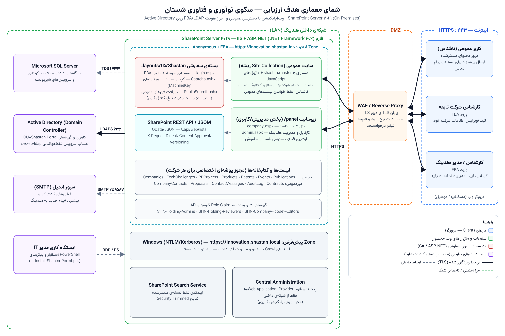

# فرم درخواست ارزیابی امنیتی محصول — سکوی نوآوری و فناوری شستان

> مقادیر داخل `[…]` اطلاعات سازمانی هستند که در مخزن کد وجود ندارند و باید توسط شرکت تکمیل شوند.
> بقیه‌ی موارد از روی کد و مستندات همین مخزن استخراج شده‌اند.

## ۱. مشخصات متقاضی

| فیلد | مقدار |
|------|-------|
| نام شرکت | [هلدینگ شستان / شرکت مجری] |
| شناسه ملی | [………] |
| نام محصول | **سکوی نوآوری و فناوری شستان** (Shastan Innovation & Technology Portal) — نسخه‌ی 0.1.0 |
| تاریخ تکمیل فرم | [……/……/۱۴۰۵] |
| راه‌های ارتباطی | تلفن: [………] — ایمیل: [………] (ایمیل اعلان‌های سامانه: `ict@shastan.ir`) |
| آدرس | [………] |
| نام و نام خانوادگی مدیرعامل | [………] |
| مدیر واحد مربوط به محصول | نام: [مدیر فناوری اطلاعات / ICT] — تلفن ثابت و همراه: [………] |
| کارشناس اداری محصول | نام: [………] — تلفن ثابت و همراه: [………] |
| کارشناسان فنی محصول | نام: [علیرضا صادق‌زاده] — تلفن: [………] نام: [………] — تلفن: [………] |

## ۲. هدف از درخواست آزمون

☑ **گواهی افتا** ☐ گواهی سازمان پدافند ☐ تأییدیه توسعه تجارت ☐ سایر
*(در صورت نیاز سازمان، گزینه‌ی دیگر را علامت بزنید.)*

## ۳. نوع محصول

| | |
|---|---|
| ☑ **Web App** | ☐ Network Device |
| ☐ Mobile App *(نسخه‌ی موبایل ندارد؛ وب‌سایت واکنش‌گرا است)* | ☐ Industrial Control (RTU, PLC, HMI, SCADA) |
| ☐ Network App | ☐ Security Device |
| ☐ Desktop App | ☐ Software Quality & Architecture (ISO 25051) |
| ☐ Software Source Code *(در صورت درخواست بازبینی کد، علامت بزنید)* | ☐ Encryption & PKI |

## ۴. توصیف محصول، زمینه‌ی فعالیت و کاربردها

سکوی نوآوری و فناوری شستان، پورتال تبادل فناوری هلدینگ شستان و شرکت‌های تابعه‌ی آن (حدود ۲۸ شرکت در حوزه‌های پتروشیمی، نفت و گاز، پالایش و روانکار، خدمات مهندسی و سرمایه‌گذاری) است و روی **SharePoint Server 2019 (On-Premises)** پیاده‌سازی شده و روی اینترنت منتشر می‌شود.

کاربردها:
- **معرفی توانمندی‌های فناورانه‌ی شرکت‌های تابعه**: پروفایل شرکت، محصولات، پروژه‌های تحقیق و توسعه، پتنت‌ها، تفاهم‌نامه‌ها، برنامه‌های توسعه، رویدادها و انتشارات.
- **نظام مسائل فناورانه (RFP)**: انتشار نیازها و چالش‌های فناورانه‌ی شرکت‌ها و دریافت پیشنهاد از شرکت‌های دانش‌بنیان (بدون ثبت‌نام، با کپچا و کد رهگیری).
- **گردش‌کار تأیید محتوا**: محتوای ثبت‌شده توسط شرکت‌ها پس از بررسی و تأیید کارشناسان هلدینگ منتشر می‌شود (تأیید / برگشت برای اصلاح / رد) و همه‌ی اقدامات در لاگ عملیات ثبت می‌شود.
- **فرم تماس با ما** برای عموم.

سه نوع کاربر:
1. **کاربر عمومی (ناشناس)** — بدون ورود؛ فقط محتوای منتشرشده را می‌بیند و پیشنهاد/پیام می‌فرستد.
2. **کارشناس شرکت تابعه** — با حساب Active Directory وارد می‌شود و فقط اطلاعات شرکت خود را ثبت و ویرایش می‌کند.
3. **کارشناس / مدیر هلدینگ** — کارتابل بررسی و تأیید، و مدیریت اطلاعات پایه.

## ۵. پیاده‌سازی‌های نرم‌افزاری محصول

| مورد | توضیح |
|------|-------|
| زبان برنامه‌نویسی و تکنولوژی‌ها | **سمت کاربر:** JavaScript (ES Modules) باندل‌شده با esbuild، HTML5، CSS کامپایل‌شده با Tailwind CSS 3.4، Font Awesome 6 (محلی، بدون CDN) **سمت سرور:** C# / ASP.NET روی .NET Framework 4.x و IIS — صفحه‌ی ورود اختصاصی (`login.aspx`) و هندلرهای HTTP (`Captcha.ashx`، `PublicSubmit.ashx`) **پلتفرم:** Microsoft SharePoint Server 2019 — سایت کلاسیک Publishing، مستر پیج سفارشی، SharePoint REST API (OData/JSON) و JSOM **احراز هویت:** Forms-Based Authentication با `LdapMembershipProvider` / `LdapRoleProvider` روی Active Directory **استقرار و پیکربندی:** اسکریپت‌های PowerShell (SharePoint Management Shell) |
| پایگاه داده‌ی محصول | **Microsoft SQL Server** (پایگاه‌های داده‌ی محتوا و پیکربندی SharePoint). داده‌های برنامه در قالب لیست‌ها و کتابخانه‌های SharePoint ذخیره می‌شوند و برنامه مستقیماً به SQL Server متصل نمی‌شود. |

## ۶. پیاده‌سازی‌های سخت‌افزاری محصول

| مورد | توضیح |
|------|-------|
| پروتکل‌های ارتباطی | HTTPS (TLS) روی پورت 443 بین کاربر، WAF و سرور؛ REST/OData با JSON؛ LDAPS (636) به Active Directory؛ SMTP (25/587) برای ایمیل؛ TDS (1433) به SQL Server؛ NTLM/Kerberos فقط در Zone داخلی |
| درگاه‌های ارتباطی Device (Serial, USB, RJ45) | **ندارد** — محصول صرفاً نرم‌افزاری است و روی سرورهای Windows Server استاندارد اجرا می‌شود (فقط کارت شبکه‌ی Ethernet/RJ45 سرور). |

## ۷. شمای معماری هدف ارزیابی

*(فایل تصویر با کیفیت بالا: [`docs/img/architecture-toe.png`](img/architecture-toe.png) — منبع قابل ویرایش: [`docs/img/architecture-toe.html`](img/architecture-toe.html))*

## ۸. اجزای محصول و کاربرد هر یک

| ردیف | نوع مؤلفه | نام مؤلفه | کاربرد |
|------|-----------|-----------|--------|
| 1 | **Web App** | سایت عمومی (Site Collection ریشه + مستر پیج `shastan.master` + ماژول‌های JS) | نمایش محتوای منتشرشده به عموم: خانه، دایرکتوری شرکت‌ها، صفحه‌ی شرکت، مسائل فناورانه، کاتالوگ، تماس با ما؛ فرم ارسال پیشنهاد و پیام |
| 2 | **Web App** | زیرسایت `/panel` — پنل شرکت تابعه (`company.aspx`) و کارتابل هلدینگ (`admin.aspx`) | ثبت و ویرایش اطلاعات شرکت (کاربران شرکت)؛ بررسی، تأیید، برگشت و رد، مدیریت اطلاعات پایه و گزارش‌ها (کاربران هلدینگ) |
| 3 | **Service** | بسته‌ی سفارشی سمت سرور `_layouts/15/Shastan`: `login.aspx`، `Captcha.ashx`، `PublicSubmit.ashx` | صفحه‌ی ورود اختصاصی FBA؛ تولید کپچای سمت سرور؛ دریافت، اعتبارسنجی و ذخیره‌ی فرم‌های عمومی کاربر ناشناس و ارسال ایمیل اعلان |
| 4 | **Service** | SharePoint REST API / JSOM (`/_api`) | دسترسی ماژول‌های JS به داده‌ها، اعمال مجوزها، Content Approval و Versioning |
| 5 | **Service** | SharePoint Search Service | جستجوی محتوای منتشرشده (Security Trimmed) — Crawl از Zone داخلی |
| 6 | **Web App** (مدیریتی) | SharePoint Central Administration | پیکربندی فارم، Web Application و Providerهای احراز هویت — فقط از شبکه‌ی داخلی |

## ۹. آیا بخش‌های مدیریتی و کاربری به‌صورت مجزا پیاده‌سازی شده‌اند؟

**بله.**
- **مدیریت محتوا:** بخش‌های مدیریتی و کاربری در زیرسایت جداگانه‌ی `/panel` قرار دارند که ارث‌بری مجوز آن قطع و دسترسی ناشناس آن خاموش است؛ هر درخواست به این بخش بدون احراز هویت به صفحه‌ی ورود هدایت می‌شود. پنل شرکت (`company.aspx`) و کارتابل هلدینگ (`admin.aspx`) دو صفحه‌ی جدا با مجوزهای جدا هستند.
- **مدیریت فنی سامانه:** از طریق مؤلفه‌ی مجزای **SharePoint Central Administration** و **PowerShell** انجام می‌شود که فقط از شبکه‌ی داخلی در دسترس هستند و از اینترنت منتشر نمی‌شوند.
- همه‌ی محدودیت‌ها با مجوزهای خود SharePoint در سمت سرور اعمال می‌شوند، نه با پنهان کردن گزینه‌ها در رابط کاربری.

## ۱۰. پارامترهای امنیتی پیاده‌سازی‌شده

**احراز هویت و مدیریت نشست**
- احراز هویت متمرکز روی Active Directory با FBA و LDAP روی **LDAPS (636)**؛ حساب سرویس LDAP فقط‌خواندنی؛ حساب‌های غیرفعال AD با `userFilter` کنار گذاشته می‌شوند.
- سیاست قفل حساب (Account Lockout) و پیچیدگی رمز عبور از Active Directory.
- محدود بودن مدت اعتبار توکن ورود (`FormsTokenLifetime` = ۶۰ دقیقه).

**کنترل دسترسی**
- دسترسی مبتنی بر نقش (RBAC) با گروه‌های AD که به گروه‌های SharePoint نگاشت می‌شوند: `SHN-Holding-Admins`، `SHN-Holding-Reviewers`، `SHN-Company-<code>-Editors`.
- جداسازی داده‌ی شرکت‌ها: یک پوشه با مجوز اختصاصی برای هر شرکت در هر لیست؛ سطح دسترسی سفارشی «ویرایش بدون حذف» برای شرکت‌ها.
- **Content Approval** + **Versioning** + **Draft Item Security**: انتشار فقط با مجوز Approve (حتی از طریق فراخوانی مستقیم REST)؛ پیش‌نویس‌ها فقط برای ویرایشگران همان شرکت و هلدینگ قابل مشاهده‌اند.
- کاربر ناشناس **هیچ مجوز نوشتنی ندارد** و فقط روی لیست‌های عمومی مجوز خواندن دارد؛ اطلاعات محرمانه (اطلاعات تماس اشخاص، قراردادها، پیشنهادها، پیام‌ها، لاگ) در لیست‌های بدون دسترسی ناشناس نگهداری می‌شوند.

**حفاظت از فرم‌های عمومی (`PublicSubmit.ashx`)**
- کپچای عددی سمت سرور با توکن امضاشده و رمزشده با `MachineKey`، اعتبار ۱۵ دقیقه و **یک‌بار مصرف**.
- فیلد تله (Honeypot) برای شناسایی ربات‌ها.
- محدودیت نرخ: حداکثر ۵ ارسال در هر ۱۰ دقیقه برای هر IP.
- اعتبارسنجی سمت سرور همه‌ی فیلدها (ایمیل، تلفن، طول فیلدها).
- کنترل فایل‌های بارگذاری‌شده: لیست سفید پسوند (pdf، doc/x، ppt/x، xls/x، zip، rar)، حداکثر ۳ فایل و ۱۰ مگابایت برای هر فایل، پاک‌سازی نام فایل.
- ذخیره با دسترسی سیستمی محدود به همین هندلر؛ کدگذاری HTML داده‌های کاربر در ایمیل‌های اعلان (`HtmlEncode`).

**امنیت ارتباطات و زیرساخت**
- HTTPS اجباری و HSTS روی Zone اینترنت؛ قرار گرفتن WAF / Reverse Proxy جلوی سرور و محدودیت نرخ درخواست به صفحه‌ی ورود.
- جداسازی Zoneها: Zone اینترنت (Anonymous + FBA) برای کاربران و Zone پیش‌فرض (Windows) فقط برای Crawl و مدیریت داخلی.
- حفاظت در برابر CSRF با توکن `X-RequestDigest` در همه‌ی درخواست‌های نوشتن به REST API.
- بارگذاری همه‌ی فایل‌های CSS، JS و فونت به‌صورت محلی، بدون وابستگی به CDN خارجی.

**ثبت رویداد و ممیزی**
- لاگ عملیات (`AuditLog`): ثبت، ارسال، تأیید، برگشت، رد و بایگانی، همراه با کاربر، زمان و توضیح.
- تاریخچه‌ی نسخه‌ها (Versioning) برای همه‌ی آیتم‌ها، به‌علاوه‌ی لاگ‌های ULS و IIS در SharePoint.

## ۱۱. ارتباط با موجودیت‌های خارجی

| ردیف | موجودیت خارجی | کلاینت | سرور | توضیح |
|------|----------------|:------:|:----:|-------|
| 1 | **Active Directory (Domain Controller)** | ✅ | | احراز هویت کاربران و دریافت گروه‌ها از طریق LDAPS (636) با حساب سرویس فقط‌خواندنی |
| 2 | **سرور پست الکترونیکی (SMTP)** | ✅ | | ارسال ایمیل اعلان: پیشنهاد جدید، پیام تماس، تأیید / برگشت / رد |
| 3 | **Microsoft SQL Server** | ✅ | | ذخیره‌سازی پایگاه‌های داده‌ی محتوا و پیکربندی SharePoint (TDS 1433) |
| 4 | **WAF / Reverse Proxy و مرورگر کاربران** | | ✅ | ارائه‌ی سرویس وب از طریق HTTPS (443) به کاربران اینترنت |
| 5 | **SharePoint Search Crawler** | | ✅ | Crawl محتوا از Zone داخلی (Windows Auth) |

- **سرور پیامک:** ندارد.
- **سرور به‌روزرسانی محصول:** ندارد؛ به‌روزرسانی‌های SharePoint (CU) به‌صورت دستی توسط تیم IT نصب می‌شوند.
- **دستگاه سخت‌افزاری خاص‌منظوره:** ندارد.
